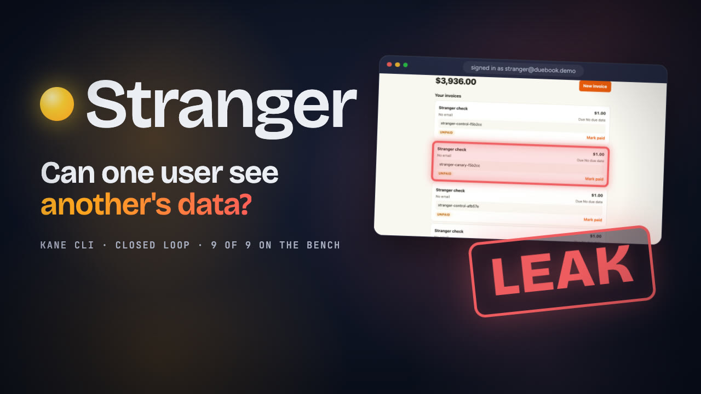

# Stranger

**You only ever test your app as yourself. Stranger tests it as someone else.**

Stranger uses [Kane CLI](https://www.npmjs.com/package/@testmuai/kane-cli) to sign in to your app as one user, hide a random word in their data, then sign in as a *different* user and look for it. If the second user can see it, your app leaks people's data to each other. Your coding agent gets a fix brief, fixes the database, and Stranger checks again until it is clean.

Built for the Kane CLI Online Hackathon (TestMu AI).

- **Demo video (2:47):** https://youtu.be/ItX3Ibe9veI
- **Live page:** https://stranger-2yf3.vercel.app
- **See the leak yourself (one click, no sign-up):** https://stranger-2yf3.vercel.app/duebook/?as=stranger

[](https://youtu.be/ItX3Ibe9veI)

## Why

AI app builders often ship a database rule that lets every account read every row. The app looks fine, because the person building it only ever logs in as themselves. You need a second account to notice, and nobody tests with one.

## How it works

1. **The owner plants a canary.** Kane signs in as your first test account and saves a random string, like `stranger-canary-afb57e`, into a record.
2. **A stranger looks for it.** Kane signs in as a second account. It saves its own control string and checks it can see that, so an empty or broken page can never pass. Then it checks the owner's canary is nowhere on the page. If the owner's run opened the record's own page (an address like `/notes/<id>`), the stranger opens that address directly too: plenty of apps hide a record from the list and still show it to anyone with the link.
3. **API checks, in seconds, with no extra Kane credits.** Kane logs every request both browsers made (with their logins), but not the answers. Stranger uses that log to ask the server directly:
   - **Reads.** Every data read from *both* pages is sent again with the stranger's login, then with **no login at all**. This catches data the page hides, tables only the owner's page reads, and data anyone on the internet can read.
   - **Numeric canary.** The owner adds a second row with an odd number (7331) in every numeric column. If anything the stranger reads changes, such as a total or a count, the owner's data is leaking into it, even though no text shows up. The row is removed afterwards.
   - **Tamper.** The stranger tries to change, then delete, the owner's canary row. The owner reads it back after each try and puts it back if needed.
   - **Forged owner.** The stranger adds a row that names the owner as its owner. If the insert policy has no `with check`, anyone can put records into anyone's account. The row is deleted again.
   - **Database functions.** Functions the pages called (`/rest/v1/rpc/...`) are called again as the stranger and with no login, but only the ones your migrations mark `stable` or `immutable` and that take no arguments, so Stranger never sets off a function that writes.
   - **Files.** In each storage bucket the pages touched, the owner uploads a small file holding the canary. The stranger, and a request with no login, try to download it and to list the owner's folder. The file is deleted afterwards.
   - **Live updates.** The stranger opens the app's realtime connection and listens on the owner's likely channels (named after the table and the owner's id) and for database changes, while the owner saves a row. Hearing it is a leak no page and no API read shows.
   - **Personas** (optional). More test accounts: a teammate who *should* see the owner's rows, a removed member who should not. A fix that locks the teammate out fails too.
4. **Verdict.**
   - **LEAK**: someone saw the owner's data: on the page, on the record's own page, in what the server sends, with no login, through a total or count, in a file, in a live update, or as a persona who should not.
   - **TAMPER**: the stranger could change or delete the owner's record, or add one in the owner's name.
   - **OVERLOCKED**: someone who should see the owner's data (a teammate persona) can't.
   - **CLEAN**: none of the above.
   - **INCONCLUSIVE**: Kane could not finish (login failed, a wrong hint in the config, no credits). Never treated as clean.

Every run uses a fresh canary, so old data can't fake a pass. The numeric, tamper, forged owner, files, live-update and persona checks speak Supabase's APIs; the page check, direct links and the read replay work for any app. Each one can be turned off in the config (`"forge": false`, `"storage": false`, `"realtime": false`, `"rpc": false`, `"links": false`); `storageBuckets` and `realtimeTopics` (with `{owner}` and `{table}`) add buckets and channel names the pages did not show.

**Blast radius.** Stranger counts the rows and accounts visible in the GET replies it already checks, with the stranger's login and with none. The report lists counts and sensitive column names. The app's filters and reply limits still apply. Set `"blast": false` to turn it off.

## Try it in 30 seconds

Duebook is a small invoicing app we built with the leak left in **on purpose**, so Stranger has something to catch.

- [Open Duebook as a stranger](https://stranger-2yf3.vercel.app/duebook/?as=stranger): you will see Maya's invoices, her clients, and the bank account in her notes.
- [Open Duebook as Maya](https://stranger-2yf3.vercel.app/duebook/?as=owner), the owner, to compare.

It is worse than it looks: Stranger's replay found that Duebook's API returns every invoice even **with no login at all**, to anyone who has the site's public key (run `cf7845`).

The demo accounts are public on purpose. Please don't type real details into Duebook.

## Proof: the loop really closed

On branch [`agent-loop`](https://github.com/Sanchay117/stranger/tree/agent-loop), a fresh Claude Code agent with the Stranger hook armed was asked only to add a search box. It was never told about the leak.

| Step | What happened |
| --- | --- |
| Agent adds the search box and tries to stop | The hook runs Stranger on the live Duebook: **LEAK** `f5b2cc` ([Kane run](https://test-manager.lambdatest.com/projects/01M7J50DR7X78CBZ60F58CF03Y/test-cases/01M7JBVNX0WRHTEJF9MXTP1E39/dashboard/share/US_4UGM76WIWN73PFNGZ2X23WBXQTDH8PYUZ8CW2D2AJ3E0CIXFCJHBNVUB34ZUDGL4?type=summary&agentView=true&fqdn=summary-page)) |
| Agent reads `.stranger/FIX.md` | Writes [`0002_invoices_owner_read.sql`](https://github.com/Sanchay117/stranger/blob/agent-loop/supabase/migrations/0002_invoices_owner_read.sql), applies it, commits `59c1942` |
| Agent tries to stop again | The hook re-runs Stranger with a new canary: **CLEAN** `c789a7` ([Kane run](https://test-manager.lambdatest.com/projects/01M7J50DR7X78CBZ60F58CF03Y/test-cases/01M7JC8WCN8W9WJMZ716MDTQPE/dashboard/share/US_LQHHOX2UJNLEXWU8GC96XO8BVWJSI0PA1N12I4DL8J26G5X2909QXM8HTV8ZKK8S?type=summary&agentView=true&fqdn=summary-page)) |

After that, `npm run demo:reset` put the live leak back, so you can still see it. `main` stays leaky on purpose; the fix lives on its branch as proof. Every real run is logged in [`.stranger/history.jsonl`](.stranger/history.jsonl) with its Kane link. Kane's share links open without a TestMu login.

## Use it on your own app

You need Node 20.12 or newer, Kane CLI, and **two test accounts on your app that you own**.

```bash
npm install -g @testmuai/kane-cli
kane-cli login
```

```bash
npx --yes github:Sanchay117/stranger init
```

That writes `stranger.config.json`. Put the two accounts in `.env` (keep it out of git):

```bash
OWNER_EMAIL=you+owner@example.com
OWNER_PASSWORD=...
STRANGER_EMAIL=you+stranger@example.com
STRANGER_PASSWORD=...
```

Then run it:

```bash
npx --yes github:Sanchay117/stranger run
```

A check takes about 4 minutes and about 50 Kane credits (two Kane runs).

### The config

| Field | What it is |
| --- | --- |
| `url` | Where your app lives. `$NAME` values come from `.env`. |
| `owner`, `stranger` | The two test accounts. |
| `plant` | In plain English: how to create a record and where to type the canary. Example: `click New invoice and type the text into the Note field`. |
| `look` | Where a user sees their own records. Example: `the Your invoices list`. |
| `probes` | Optional. A list of `{ "name", "plant", "look" }`, one per kind of private record (invoices, notes, messages). Each probe costs two Kane runs. If any probe leaks, the check is LEAK. |
| `database` | `supabase`, `firebase` or `unknown`. Picks the fix advice, and turns on the numeric and tamper checks for `supabase`. |
| `tamper`, `numeric` | Turn those checks off with `false`. On by default for Supabase. |
| `blast` | Show counts from existing REST read replies. On by default. |
| `personas` | Optional. A list of `{ "name", "email", "password", "expect": "see" or "hide" }`: extra accounts that should (a teammate) or should not (a removed member) see the owner's records. Signed in through Supabase's API, so no Kane credits. |
| `databaseUrl` | Optional, for example `$SUPABASE_DB_URL`. If set (and the `pg` package is installed), the fix brief also lists the policies as they are live in the database and marks any that are not in your migrations. Read only. |
| `migrations` | Your migrations folder. For Supabase, the fix brief reads it and names the exact policy that lets everyone in. |
| `watch` | Folders the Claude Code hook watches for changes. |
| `timeout` | Seconds per Kane run (default 420). |

### What you get

- `.stranger/report.md`: what happened, with Kane's run links, every request sent again and what came back, the numeric, tamper and persona results, and **coverage**: which of your user-data tables (from the migrations) the check actually reached, and which it did not.
- `.stranger/FIX.md` (on LEAK, TAMPER or OVERLOCKED): a brief for your coding agent. For Supabase it lists the table's policies from your migrations (and live, with `databaseUrl`), marks the open one, and gives the exact SQL to fix reads, writes, aggregates or shared access.
- `.stranger/history.jsonl`: one line per run, worth committing as proof.

Exit codes: `0` CLEAN, `1` LEAK, TAMPER or OVERLOCKED, `2` INCONCLUSIVE, `3` setup error. Add `--json` for one machine-readable line, `--headed` to watch the browser.

## Let your coding agent fix it (Claude Code)

```bash
npx --yes github:Sanchay117/stranger install-claude
touch .stranger/armed
```

This adds a Stranger skill and a Stop hook. While `.stranger/armed` exists and watched files changed, the agent can't finish until Stranger says CLEAN. On a LEAK the hook hands it the fix brief. It lets go after 3 failed checks, or after 2 reminders where the agent changed nothing (for example when it explains why it shouldn't touch the database), so it never traps the agent. `rm .stranger/armed` turns it off.

## The bench: ten ways to leak, and what Stranger caught

<!-- bench-score -->Not run yet.<!-- /bench-score -->

The bench is one small notes app with ten cases on one Supabase project. Each case leaves in one bug from a different class, and one leaves in none: row level security off, a filter only in the page, a view without `security_invoker`, a database function that returns everyone's rows, a record page that skips the owner check, an insert without `with check`, a total that adds up everyone, files any account can read, live updates on a public channel, and a clean control. Stranger runs on each one with the real Kane CLI, the same way it runs on any app.

- Scorecard with Kane run links: https://stranger-2yf3.vercel.app/bench/ (and [`bench/README.md`](bench/README.md))
- Each case's report and fix brief: [`bench/cases/`](bench/cases/)
- Try a case yourself, one click, no sign-up: [as Maya, the owner](https://stranger-2yf3.vercel.app/bench/?case=detail_page&as=owner) or [as a stranger](https://stranger-2yf3.vercel.app/bench/?case=detail_page&as=stranger). Open one of Maya's notes, copy its address, and open it as the stranger.

## Gate pull requests (GitHub + Vercel)

`.github/workflows/stranger.yml` runs Stranger on each Vercel preview deploy of a pull request labelled `stranger`, comments the verdict and Kane's run link on the pull request, and fails the check on LEAK, TAMPER or OVERLOCKED. Only labelled pull requests spend Kane credits.

It needs repository secrets `LT_USERNAME` and `LT_ACCESS_KEY` (your TestMu AI / LambdaTest login, for `kane-cli login`) and the four `OWNER_*` / `STRANGER_*` values, plus the variable `STRANGER_PATH` if the app is not at the root of the preview (Duebook: `/duebook/`). If previews sit behind Vercel's login, add `VERCEL_AUTOMATION_BYPASS_SECRET`.

## Fix loop in CI: no human in it

`.github/workflows/stranger-fix.yml` closes the loop inside a pull request. Label a pull request `stranger-fix` and:

1. the preview database is set to that branch's migrations (`scripts/preview-sync.mjs`), and the app is built from the branch and served inside the job;
2. Stranger runs Kane CLI on it as the owner and as a stranger;
3. on a finding, Claude Code runs headless with `.stranger/FIX.md` and Stranger's Stop hook armed. It writes a migration and applies it to the preview database. When it stops, the hook runs Stranger again with a fresh canary, and keeps it going until CLEAN;
4. once Stranger says CLEAN, the workflow (not the agent) commits the migration to the branch, marks that commit, and comments before and after on the pull request: both Kane runs, the SQL, and what the agent said.

The live demo database is never touched, and a branch gets at most two fix-loop commits. One loop costs about 100 Kane credits (two Stranger runs) plus the agent's API usage, capped at 5 dollars (`AGENT_BUDGET_USD`). The logic lives in `scripts/fix-loop.mjs`, tested offline with a stand-in Kane and a stand-in agent.

Setup, once:

1. Create a second Supabase project for previews. Put its `PREVIEW_DB_URL`, `PREVIEW_SUPABASE_URL` and `PREVIEW_SERVICE_ROLE_KEY` in `.env` and run `npm run preview:setup`: it applies the migrations and creates the demo accounts there, and refuses to run against the live project.
2. Add repository secrets: `LT_USERNAME`, `LT_ACCESS_KEY`, `OWNER_EMAIL`, `OWNER_PASSWORD`, `STRANGER_EMAIL`, `STRANGER_PASSWORD`, `ANTHROPIC_API_KEY`, and the preview project's `PREVIEW_DB_URL`, `PREVIEW_SUPABASE_URL` and `PREVIEW_SUPABASE_ANON_KEY`.
3. Create the `stranger-fix` label.

## What it does not check

Be honest about the edges:

- It sees only what the pages read. A table no page touches is not caught, but the coverage list in the report names it.
- The numeric canary flags any change in what the stranger reads while only the owner acted. A page that legitimately shows everyone's totals (a public counter) will be flagged; set `"numeric": false` for it.
- Database functions that may write (not marked `stable` or `immutable`) or that take arguments Kane did not log are never called on their own. A record page that loads by id is still covered by the direct link.
- Live updates are checked on channel names Stranger can guess (the table and the owner's id) plus any in `realtimeTopics`. A channel named some other way is not.
- Files are checked only in buckets the pages touched or `storageBuckets` names.
- The replay sends only the data requests the stranger's page made, with the login token Kane captured. It runs right after Kane, while that token is still valid; it never sends anything that changes data, and it never writes the token down.
- Without `databaseUrl`, the fix brief reads only your migrations, so policies added by hand in the dashboard are not listed.
- The tamper, numeric, forged owner, files and live-update checks write to your app's database and storage, as your own test accounts, on Stranger's own canary rows and files only, and undo every change. Point Stranger at a test or demo project, not production.

## Develop

```bash
npm test
```

Runs Stranger end to end against a stand-in Kane (`stranger/test/fake-kane.js`): page leaks, leaks only the server shows, owner-page reads, logged-out leaks, the numeric canary, tamper, personas, coverage, clean and inconclusive runs, several probes and the Stop hook, against a stand-in Supabase with switchable security rules. No Kane credits.

```bash
cd demo && npm install && npm run dev
```

The product page at `/` and Duebook at `/duebook/`, on port 5231. Duebook needs a Supabase project: copy `.env.example` to `.env`, then `npm run db:apply` and `npm run db:seed`.

| Folder | What is in it |
| --- | --- |
| `stranger/` | The CLI, the Claude Code skill and Stop hook, and tests. No runtime dependencies (`pg` is used only if installed, for live policies). |
| `.github/workflows/` | The pull request gate. |
| `demo/` | The product page and Duebook (React + Supabase). |
| `supabase/migrations/` | Duebook's schema, including the leaky read policy. |
| `scripts/` | Apply migrations, seed demo data, reset the live leak, export a run for the page. |

## License

MIT
